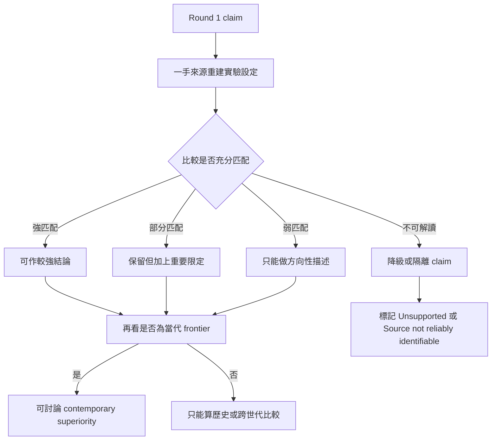
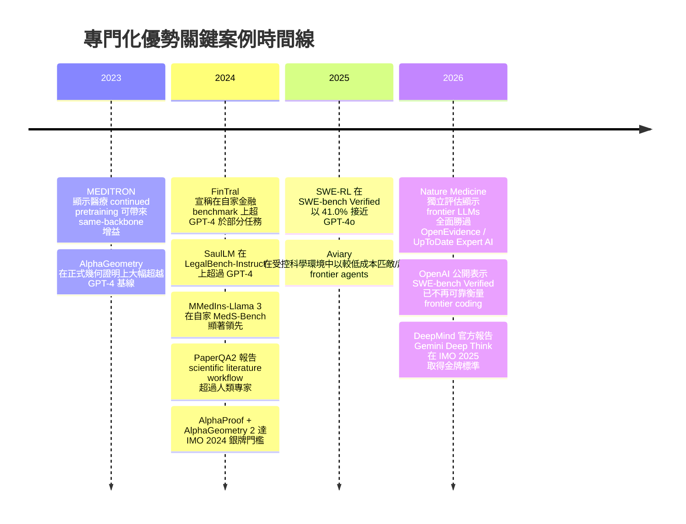

# 專門化優勢的驗證、判別與邊界條件報告

## 執行裁決摘要

雖然原始對話把主題描述成「未指定」，但你上傳的 DR2 brief 已把研究問題明確定義為：**在什麼經實驗支持的條件下，specialization 只會帶來相對於 base model 的增益；又在什麼條件下，它會或不會形成對強 general-purpose systems 的穩定、可泛化、且當代的優勢**。該 brief 也明確要求把結論拆成 model-level specialization、system-level specialization、hybrid specialized capability systems，以及 narrow task-specific or formal solvers 四類，而不能混成單一結論。以下報告因此以這份 brief 為權威研究範圍。fileciteturn3file0

整體裁決是：**「專門化通常能提升被適配的 base model」這句話仍然成立，但主要成立在「same-backbone 的相對增益」層次；若把標準提高到「在資源匹配、資訊存取匹配、時間上當代、且跨任務持久地勝過強 generalists」，可靠證據就明顯變少。** SaulLM、MMedIns、MEDITRON、SWE-RL 這類案例支持「專門化能改善 base model」；但它們大多不是乾淨證明「model-level specialization 對 contemporary frontier 有穩定優勢」。相反地，最強、最穩的 specialist wins 往往出現在 **system-level specialization** 或 **formal / verifier-bound settings**，例如 PaperQA2、Aviary、AlphaProof、AlphaGeometry 這些把 retrieval、search、verifier、specialized environment、test-time compute 一起打包的系統。citeturn18academia45turn20search3turn25academia35turn29academia14turn22view5turn6view13turn8view4

Round 1 中最需要重分類的幾個案例如下。**MMedIns-Llama 3 / MedS-Bench** 的確在原作者自己的 benchmark 上表現極強，但 benchmark 與 instruction corpus 都來自同一研究計畫，而且 repo/網站可確認 MedS-Bench 與 MedS-Ins 是同一團隊共同建置；公開可見的比較只明示使用 few-shot prompting，卻沒有清楚標出 GPT-4 與 Claude-3.5 的精確 snapshot，外部獨立 replication 也沒有在本次一手來源搜尋中浮現，因此它比較像是「benchmark-local、same-program specialist win」，而不是已完成 contemporary frontier 驗證的反例。citeturn35view1turn35view2turn35view3turn21search0

**Clinical specialist tools versus frontier generalists** 這條在 Round 1 中若原本來源不清，現在已可直接對應到 2026 年的 *Nature Medicine* 獨立評估。該研究把 OpenEvidence 與 UpToDate Expert AI，對比 GPT-5.2、Gemini 3.1 Pro、Claude Opus 4.6，分別在 500 題 MedQA、500 題 HealthBench，以及 100 個真實醫師臨床查詢上做比較；結果是 frontier LLMs 在三個階段都勝過兩個 clinical AI tools。這是本輪最直接、也最有份量的「later frontier generalists 反超 clinical specialist tools」證據之一。不過作者也同時提醒：clinical tools 沒有公開 API，只能透過瀏覽器操作；HealthBench 又是 OpenAI benchmark，因此這個案例支持的是**「現成 clinical tool packages 並未自動勝過 frontier generalists」**，不是「所有醫療 specialization 都無效」。citeturn32search0turn30search0

**SaulLM** 是貨真價實的 model-level legal specialist counterexample，但結論必須收窄。官方 paper／model card 顯示 SaulLM-54B/141B 基於 Mixtral 架構，legal pretraining 規模超過 540B legal tokens；在 LegalBench-Instruct 上，官方摘要報告 75.34% mean balanced accuracy，超過 GPT-4 的 73.35% 與 Llama3-70B 的 70.20%。然而，精確 GPT-4 版本、prompt protocol、benchmark contamination 分析、以及跨更多法律工作流的獨立 replication，仍不夠清楚；而在另一類更接近 legal writing / exam workflow 的公開評估中，Claude-3.5 Sonnet 在 oab-bench 上取得最佳表現，TW-LegalBench 也顯示 frontier models 在法律資格考題上已可接近甚至超過部分人類門檻，但在 citation-precision 與可靠長文生成上仍有限制。這表示 SaulLM 目前較穩的命題是：**它反駁「generalists 在所有 legal benchmarks 都穩贏」**；但它還不能穩定反駁「frontier generalists 最終會在更廣 법務工作流中反超」。citeturn18academia45turn37view1turn37view4turn36search1turn27academia23turn36academia48

**FinTral** 需要更大幅度地降級解讀。它的 primary paper 明確說明模型建立在 Mistral-7B 上，並加入 domain-specific pretraining、instruction fine-tuning、RLAIF，以及 DPO with Tools and Retrieval；它也聲稱在自家九任務、二十五資料集 benchmark 上，對 ChatGPT-3.5 全勝，並在五項任務超過 GPT-4。然而同一篇 paper 也明示 benchmark 是作者自己提出，且比較中把 retrieval、tools、multimodal inputs 一起打包進系統；精確 GPT-4 版本、資訊存取對齊、以及 point-in-time temporal control 並未在可得 primary material 中充分釐清。更關鍵的是，後續金融研究顯示，**tool availability 與 temporal validity 會主導結果**：FinRetrieval 發現同一 frontier model 若有 structured data APIs 可達 90.8% accuracy，但只用 web search 會掉到 19.8%；Look-Ahead-Bench 也專門指出金融任務若沒有 point-in-time 控制，look-ahead bias 會嚴重污染評估。故 FinTral 應被重分類成：**finance system-level specialization with asymmetric resources 的證據**，而非乾淨的 model-level specialist frontier superiority。citeturn11view0turn19academia42turn19academia43

**SWE-RL** 的地位也需要重新界定。Primary paper 支持它是強力的 same-backbone gain：在 Llama 3 上做 RL，利用 software evolution data 與 rule-based reward，Llama3-SWE-RL-70B 在 SWE-bench Verified 達到 41.0%，並對五個 out-of-domain 任務帶來改善。問題在於：paper 摘要對 GPT-4o comparator 只寫到「comparable」，沒有公開精確版本、agent scaffold、token/wall-clock budget；而且到 2025–2026 年，GPT-4.1 先把 SWE-bench Verified 拉到 54.6%，之後 GPT-5.2 官方又報到 80%。更致命的是，OpenAI 在 2026 年正式表示 SWE-bench Verified 已日益 contaminated，不再適合作為 frontier coding capability 的可靠量尺。於是 SWE-RL 最穩的命題是：**它證明 coding specialization 能為同家族 backbone 帶來真實提升，而且在特定歷史時間點接近 frontier**；但它不再能支持「coding specialist 持續領先 contemporary frontier generalists」。citeturn25academia35turn15search0turn26search0turn26search3

最強、最不該被誤讀的 specialist 反例，其實是 **system-level** 與 **formal-solver** 類。PaperQA2 的 paper 與官方 repo 一致顯示，它靠的是 agentic RAG、paper search、metadata-aware embeddings、LLM reranking、contextual summarization，以及多個 model calls；它在三種 scientific literature workflows 上可匹配或超過 subject matter experts，而 repo 目前的預設模型甚至直接是 `gpt-4o-2024-11-20`。Aviary 也不是純權重 specialization；它是在五個受控環境中，透過 online training 與 inference-time scaling，讓 open-source 非 frontier LLM agents 能以更低成本匹敵甚至超過 frontier agents 與人類。AlphaProof / AlphaGeometry 更明顯：它們的優勢仰賴 formalization、verifier、search 與大量 test-time compute；DeepMind 官方甚至明說 IMO 2024 時，需要先把題目人工轉成 formal language，部分題目解題耗時可達兩到三天。這些案例**非常強力地反駁「generalist systems 在所有 specialized environments 都自然佔優」**，但它們同時也**不應被翻譯成「model-level domain specialization 一般性勝過 contemporary frontier」**。citeturn22view5turn17search0turn17search1turn6view13turn33search1turn8view4

## 研究範圍與方法

本次報告依照上傳的 DR2 brief，採兩階段流程：先做 **Stage A — Primary-Source Verification**，再做 **Stage B — Discriminating Evidence Research**。判準也遵循 brief：重點不是累積更多引文，而是把每個 specialist/generalist claim 重新分成 strongly matched、partially matched、weakly matched 或 not interpretable，並強制區分 model/training、system resources、inference resources、evaluation 四個面向。fileciteturn3file0

在實務操作上，我優先使用原始論文、官方 benchmark / repo、官方 model card、官方研究部落格與正式 technical reports；對能直接用 primary sources 驗證的關鍵命題，避免依賴二手摘要。若 primary material 無法確認某個關鍵欄位，例如 comparator exact version、prompt protocol、token budget、contamination control、temporal fence，我把它明確記為 **Unknown**，而不做推論。這個做法尤其重要，因為 DR2 brief 已明確把「不要從缺失欄位硬推論」列為硬性要求。fileciteturn3file0

下圖概括本次研究的判讀流程。

為了把「specialist 優勢是否能持久存在」這件事放進時間維度，下列時間線整理了本輪判讀中最重要的案例與其意義。citeturn29academia14turn13academia29turn18academia45turn22view5turn25academia35turn32search0turn26search0turn33search0

## 一手來源驗證帳

下表把 DR2 brief 指定的高優先案例，重建成「原始命題 → 可驗證設置 → 缺失資訊 → 目前最窄且最可靠的解釋」。fileciteturn3file0

| 案例 | 驗證後的核心設置 | 主要缺失 | 觀察到的結果 | 匹配度 | 狀態 | 解釋應如何改寫 |
|---|---|---|---|---|---|---|
| MMedIns-Llama 3 / MedS-Bench | 同一研究計畫建立 MedS-Bench 與 MedS-Ins；MedS-Bench 含 11 類 clinical tasks、源自 39 datasets；MedS-Ins 含 58 corpora、5M instances、19K instructions、122 tasks；官網顯示 comparator 以 few-shot prompting 評測，MMedIns-Llama 3 在多數任務大幅領先。citeturn35view1turn35view2turn35view3turn21search0 | GPT-4 / Claude-3.5 的精確版本、完整 contamination safeguards、外部 replication、跨 benchmark 驗證。citeturn20search3turn21search0 | 原始 benchmark 上屬於明確 specialist win。citeturn21search0 | 部分匹配 | **Confirmed with important qualification** | 可支持「specialization 改善了 adapted base model」，但目前更像 **benchmark-local medical win**，不足以證成 contemporary frontier superiority。 |
| Clinical specialist tools vs frontier generalists | *Nature Medicine* 2026 直接比較 OpenEvidence、UpToDate Expert AI 與 GPT-5.2、Gemini 3.1 Pro、Claude Opus 4.6；以 500 MedQA、500 HealthBench、100 RCQ 醫師真實查詢做評估；RCQ 由 12 位美國臨床醫師盲評。citeturn32search0 | Clinical tools 無 API，只能 browser testing；HealthBench 有 benchmark–developer overlap 風險。citeturn32search0turn30search0 | Frontier LLMs 在三階段都勝過兩個專科工具。citeturn32search0 | 強匹配但仍有介面差異 | **Confirmed substantially as represented** | 這條應升級為本輪核心反例：**later frontier generalists 可在醫療 benchmark 與真實臨床查詢上壓過現成 specialist clinical tools**。 |
| SaulLM | SaulLM-54B / 141B 基於 Mixtral；legal continued pretraining >540B legal tokens；HF model card 說明其訓練集中在美國與歐洲法律文本；官方摘要報告在 LegalBench-Instruct 上 75.34%，高於 GPT-4 的 73.35% 和 Llama3-70B 的 70.20%。citeturn18academia45turn37view1turn37view4turn36search0 | GPT-4 exact version/date、完整 prompt protocol、per-category primary tables、獨立 workflow replication。 | 存在可信的 legal benchmark specialist win。citeturn36search0 | 部分匹配 | **Confirmed with important qualification** | 最可靠的命題是 **benchmark-level legal specialist counterexample**；尚不足以證明 broad legal workflow superiority。 |
| FinTral | FinTral 建立於 Mistral-7B；加入 domain pretraining、instruction FT、RLAIF；DPO-T&R 把 tools / retrieval / multimodality 納入；作者同時提出 9-task、25-dataset benchmark。citeturn11view0turn13search2 | GPT-4 exact version、information-access parity、point-in-time controls、benchmark externality。 | 論文聲稱對 ChatGPT-3.5 全勝、對 GPT-4 在 5/9 項任務領先。citeturn11view0 | 弱到部分匹配 | **Weakened** | 應改寫成 **finance system-level advantage under author-owned benchmark and asymmetric resources**；不能直接歸因為純 specialization。 |
| SWE-RL | 在 Llama 3 上以 open-source software evolution data 與 rule-based reward 做 RL；Llama3-SWE-RL-70B 在 SWE-bench Verified 達 41.0%，並提升 5 個 out-of-domain tasks。citeturn25academia35 | GPT-4o exact snapshot、scaffold parity、token/wall-clock parity。 | 是明確的 same-backbone gain；但 GPT-4.1 已達 54.6%，GPT-5.2 官方報 80%，且 OpenAI 2026 認定 SWE-bench Verified contaminated。citeturn15search0turn26search0turn26search3 | 部分匹配且 benchmark 失效 | **Reclassified** | 應改寫成 **historical / same-backbone coding gain**，不是 contemporary frontier superiority。 |
| PaperQA2 | 以 literature search、metadata-aware embeddings、LLM reranking、contextual summarization、agentic tool use 組成；paper 稱在三個 realistic literature tasks 上可 match / exceed subject-matter experts；官方 repo 現行預設為 `gpt-4o-2024-11-20` 與 OpenAI embeddings。citeturn22view5turn17search0turn17search1 | 嚴格 matched-budget ablation、對照模型純權重與系統元件貢獻拆解。 | 支持 system-level specialist superiority。citeturn22view5 | 部分匹配 | **Confirmed with important qualification** | 反駁的是 **「generalist systems 自然優於 scientific workflow specialists」**，不是「specialized weights 單獨優於 frontier」。 |
| Aviary | 五個環境，其中三個是高難度科學生物環境；透過 online training 與 inference-time scaling，開源非 frontier agents 可 match / exceed frontier LLM agents 與 humans，成本可低至 100×。citeturn6view12turn6view13 | base model exact variants、full scaffold parity、generalization 到環境外任務。 | 系統級、環境綁定的 specialist win。citeturn6view13 | 部分匹配 | **Confirmed with important qualification** | 支持 **bounded environment specialization**，不支持廣義 model-level dominance。 |
| AlphaProof / AlphaGeometry | AlphaGeometry 以 100M synthetic theorem–proof examples 訓練，於 IMO-AG-30 解出 25/30；同文中 GPT-4 對自然語言完整幾何證明成功率為 0%。AlphaProof 在 Lean verifier 環境中學習，於 2024 IMO 形式化後解出 3/5 個非幾何題；DeepMind 官方說整套 AlphaProof+AlphaGeometry 2 需人工 formalization、部分題目計算兩到三天，後來 2025 年 Deep Think 端到端自然語言拿到金牌標準。citeturn6view15turn6view16turn8view6turn8view1turn33search1turn33search0 | 與 contemporary natural-language frontier 的完全匹配比較。 | formal solver 優勢極強，但高度依賴 verifier / formalization / search。 | 弱到部分匹配 | **Reclassified** | 反駁的是 **「general systems 在 formalized exact-verifier domains 自然佔優」**；不等於一般數學或一般 domain specialization 的普遍優勢。 |

## 跨案例綜合與邊界條件

先看最核心的 DR2 問題：**文獻是否支持「specialization 是獨立 scaling 軸」？** 現階段最合理的評級是 **弱到中度支持一些局部縮放關係，但不足以建立獨立 scaling law**。原因是控制最乾淨的研究仍然偏少，而且常把模型大小、繼續預訓練 token、instruction tuning、RL、retrieval、agent scaffold 一起改動。即便如此，仍有幾條值得保留的訊號：legal domain 的 controlled study 指出，在 1.5B、3B、7B、14B 模型上做 continual pretraining 時，**specialized vs generalized training 的 compute-effectiveness gap 隨 model size 增大而擴大**；金融 continued pretraining 的研究則顯示前 200M tokens 帶來最大收益，其後出現明顯 diminishing returns，而且 general-domain validation loss 幾乎不變；AlphaGeometry 的 ablation 又顯示，哪怕只用 20% training data 仍能解 21 題，且在大幅壓低 beam/search budget 後仍可維持接近 state-of-the-art，表示 specialization 的收益可能先大、後緩、再進入飽和，而不是無限線性成長。綜合來看，文獻比較支持的是 **「specialization 有可觀但會飽和的局部收益曲線」**，而不是已經被證明的獨立 scaling axis。citeturn28academia25turn18academia47turn8view7turn8view8

再看 **advantage 的真正來源**。本輪最穩的結論是：**weights 當然重要，但許多最大幅度、最穩定的 specialist wins，並不來自 weights alone，而來自整個 system stack。** MEDITRON、MMedIns、SaulLM、SWE-RL 這些案例支持「just adapting the backbone」可以帶來真實收益；但 PaperQA2、FinTral、Aviary、AlphaProof、AlphaGeometry 則都把 retrieval、external corpus、tool APIs、verifier、search、test-time scaling、environment design 打包進共同系統，且金融領域甚至有直接證據顯示 **tool availability 的影響遠大於單純 model selection**。這代表若研究問題不先把「model-level specialization」與「system-level specialization」拆開，就會把完全不同的機制混成同一個謎題。citeturn29academia14turn18academia45turn25academia35turn19academia42turn22view5turn6view13turn8view4

至於 **benchmark proxy vs workflow capability**，本輪只能給出 **部分支持、但不能把它總結成單一方向性的 ranking reversal**。醫療領域裡，clinical specialist tools 與 frontier generalists 在 benchmark（MedQA、HealthBench）與 real workflow（RCQ 臨床查詢）上的排序是一致的：frontier LLMs 都更強。科學領域則相反，PaperQA2 在 literature search / synthesis workflow 上擊敗人類專家，但它的優勢恰恰是工作流系統工程的成果，而不是單一 base model 的天然優勢。Aviary 也顯示，在專門設計的 scientific environments 中，system-level specialization 可以使非 frontier backbones 贏過 frontier agents；但這種勝利是否能外推到環境之外，primary evidence 仍不足。最保守的說法是：**workflow fidelity 的提高，確實更容易讓 retrieval、tools、verifier、search 這些 specialist system components 變重要；但它不必然讓 specialist rankings 普遍上升或下降。** citeturn32search0turn22view5turn6view13

對 **durability / persistence** 的裁決也相當明確。從 coding 和 mathematics 的時間序列看，很多 specialist wins 只有短暫領先窗口。SWE-RL 在 2025 年初是 medium-sized coding specialist 的亮點，但很快被更新世代的 frontier generalists 超過，而且 benchmark 本身又在 2026 年被官方宣告 contaminated。AlphaProof / AlphaGeometry 在 2024 年達到銀牌門檻，是 formal mathematics 的歷史突破；但一年後 DeepMind 以更 general natural-language reasoning 取向的 Gemini Deep Think 取得官方金牌標準，且不再需要人工 formalization 與多天計算。這些案例共同指出：**specialist advantage 經常不是 capability 消失，而是 frontier moving target 變動過快，或 benchmark validity 被侵蝕。** 因此如果不把「historical superiority」與「contemporary superiority」分開，討論很容易失真。citeturn26search0turn26search3turn33search1turn33search0

下表把本輪綜合後的「邊界條件地圖」壓縮成可直接放進後續問題定義的版本。

| 邊界條件 | 目前較穩的觀察 | 證據狀態 |
|---|---|---|
| **Same-backbone、只改 specialization data / RL / instruction** | 通常能帶來相對於 base model 的可觀增益。citeturn29academia14turn18academia45turn25academia35turn20search3 | 實驗支持的 moderator |
| **要求 matched access、matched tools、matched inference budget，且與 contemporary frontier 比** | 可靠的 model-level specialist 優勢非常少；多數案例轉為部分匹配或歷史比較。citeturn11view0turn25academia35turn32search0 | 實驗支持的 moderator |
| **工作流高度依賴 retrieval / external corpus / tools / verifier** | system-level specialization 較容易產生明顯優勢。citeturn22view5turn6view13turn19academia42turn8view4 | 強 |
| **formalizable task + exact verifier + 大量 search / test-time compute** | narrow solver superiority 可以非常強，但外推必須非常保守。citeturn8view4turn8view7turn33search1 | 強 |
| **作者自建 benchmark 且 specialist 與 benchmark 同程式生成** | 易出現 benchmark-local win，不能直接推為 broad domain superiority。citeturn35view1turn35view2turn11view0 | 強 |
| **金融等高度時間敏感任務缺乏 point-in-time / access control** | specialist/generalist 排名很可能被 temporal leakage 與 tool asymmetry 扭曲。citeturn19academia42turn19academia43 | 強 |
| **公共 benchmark 經過多代模型反覆訓練與宣傳** | contamination 與 benchmark saturation 會快速削弱「specialist win」或「generalist win」的可解釋性。citeturn26search0 | 強 |
| **specialization intensity 持續增加** | 有局部收益，但常出現 diminishing returns / 飽和；尚未證成獨立 scaling law。citeturn28academia25turn18academia47turn8view7 | 中 |

## 可執行建議與剩餘證據缺口

若這份報告的用途是直接回寫到 `Evidence Base v1.1` 與問題定義修訂，我的建議不是再擴增案例，而是先做三個乾淨的結構性修正。第一，**把原始 puzzle 強制拆成至少三個子問題**：`same-backbone relative gains`、`system-level specialist superiority`、`narrow formal/solver superiority`。因為這三類的證據機制與失真模式都不同，如果再聚合為一句「specialists rarely beat generalists」，後續任何假說都會建立在混雜變量之上。fileciteturn3file0

第二，請直接把一些常被誤解的案例重標。**MMedIns、SaulLM、SWE-RL** 應標成「model-level relative gains with partial matching」；**FinTral、PaperQA2、Aviary** 應標成「system-level specialized capability systems」；**AlphaProof / AlphaGeometry** 應標成「formal solver / verifier-bound specialization」。這樣可以避免把 FinTral、PaperQA2 這種「工具加檢索加工作流控制」的勝利，誤寫成「specialized weights 勝利」。citeturn11view0turn22view5turn6view13turn8view4

第三，關鍵欄位一定要從現在起強制保留 `Unknown`，尤其是 comparator exact version、tool parity、inference budget、temporal controls、benchmark ownership、contamination controls。因為本輪最常見的問題，不是 evidence 完全不存在，而是**很多看似強烈的結論，其實只差一個未公開 comparator version 就必須降級**。SaulLM、MMedIns、FinTral、SWE-RL 都屬於這類案例。citeturn18academia45turn20search3turn11view0turn25academia35

目前最影響問題定義的證據缺口，有四個特別值得優先補。其一是 **MMedIns 的獨立、當代、跨 benchmark replication**：目前我沒有在 primary-source 檢索中找到足夠強的一手 follow-up 去證明它在外部 workflow benchmarks 上仍優勢穩定。其二是 **SaulLM 的 broader legal workflow replication**：它在 LegalBench-Instruct 上很強，但對 citation accuracy、long-form drafting、多司法轄、多文件工作流能否持續領先，證據不夠。其三是 **PaperQA2 / Aviary 的 matched-budget ablation**：兩者都非常像 system-design 的勝利，但還欠缺把 base model、retrieval、agent policy、test-time compute 完整拆開的乾淨對照。其四是 **fresh / private / post-cutoff coding benchmarks**：在 OpenAI 已明說 SWE-bench Verified 不再可靠後，任何拿 SWE-RL 去論證 frontier persistence 的做法，都不應再視為決定性證據。citeturn26search0turn22view5turn6view13

最後，用 DR2 brief 要求的直答形式收束，本輪九個核心問題可先整理成下表。fileciteturn3file0

| 問題 | 目前回答 | 最窄的可支持結論 |
|---|---|---|
| specialization usually improves the adapted base model 是否仍成立 | **Supported** | 在 same-backbone 條件下，多數案例仍支持相對增益。citeturn29academia14turn18academia45turn25academia35turn20search3 |
| 是否有可靠證據顯示 model-level specialization 能產生 contemporary frontier superiority | **Partially supported at best** | SaulLM 是強候選，但仍偏 benchmark-local；其餘多數案例不足。citeturn18academia45turn27academia23turn36academia48 |
| 是否有可靠證據顯示 system-level specialization 能產生 contemporary frontier superiority | **Supported** | PaperQA2、Aviary、formal solvers 都支持在特定環境中，system specialization 可贏。citeturn22view5turn6view13turn8view4 |
| 最強 specialist wins 是 broad and generalizable 還是 bounded | **Mostly bounded** | 多數最強勝利被 task distribution、環境、verifier、資料存取或 benchmark 設計所界定。citeturn11view0turn6view13turn8view4 |
| evaluation realism 是否系統性改變 specialist/generalist 排名 | **Currently indeterminate** | realism 會放大 system components 的重要性，但不保證 specialist 一定上升或下降。citeturn32search0turn22view5 |
| literature 是否已建立 independent specialization scaling effect | **Unsupported as a strong claim** | 只有局部、弱到中的縮放訊號，仍無獨立 scaling law。citeturn28academia25turn18academia47turn8view7 |
| 哪些 counterexamples 真正削弱原始 puzzle | **SaulLM、PaperQA2、Aviary、AlphaProof/AlphaGeometry、Nature Medicine 2026 clinical-tool comparison** | 但每個反駁的命題不同，不能一概而論。citeturn18academia45turn22view5turn6view13turn32search0turn8view4 |
| 問題定義哪些部分應保留 | **應保留** | 「specialization 是否只帶來相對增益，還是能形成穩定 superiority」這個核心問題仍有效。fileciteturn3file0 |
| 問題定義哪些部分必須縮窄或拆分 | **必須拆分** | 至少要拆成 model-level、system-level、formal solver 三塊；finance/coding 另需 temporal-validity 子問題。fileciteturn3file0 |

總結成一句話：**DR2 並沒有推翻 specialization 的重要性；它真正做的是把「specialization 是否有效」重新精煉成「在哪一層有效、靠什麼組件有效、在什麼比較條件下仍然有效、以及它能維持多久」這四個更可驗證的問題。** 這比原先的單一句 puzzle 更窄，但也更接近後續能形成可檢驗假說的狀態。fileciteturn3file0turn32search0turn19academia42turn26search0turn33search0